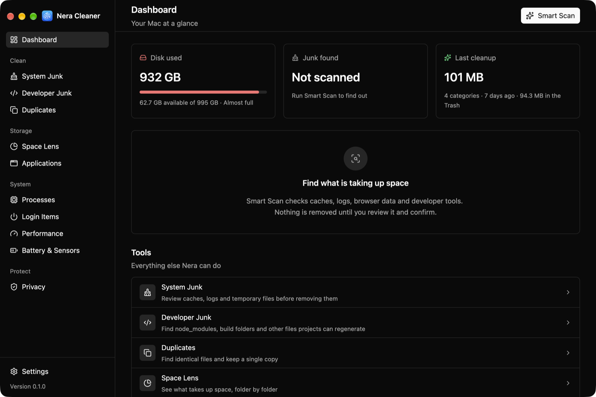

# Nera Cleaner

A native cleaner and system monitor for macOS and Windows, written in Rust with
[GPUI](https://www.gpui.rs) (`gpui-kit` 0.9.1).




Every number the app shows is checked against an independent source on that platform (macOS: Finder, Activity
Monitor, `pmset`, `system_profiler`, `du`, `launchctl`; Windows: File Explorer, Task Manager, Settings, the
registry). Values the system offers no way to verify are labelled as such or left out instead of being shown as
fact.

## Features

| Screen | What it does |
|---|---|
| **Dashboard** | Disk use (Finder's "available" figure), junk found, last cleanup, Smart Scan |
| **System Junk** | Caches, logs and temporary files by category; review before anything is removed. After a cleanup it reports the free space the disk itself shows, before and after. Also shows what a cleaner must not delete but you may want to free: cloud-drive files stored on the Mac (Google Drive, iCloud, OneDrive) and Siri / Apple Intelligence data, each with the supported way to release it |
| **Developer Junk** | `node_modules`, build folders, Xcode/Gradle/Cargo caches that projects can regenerate |
| **Duplicates** | Identical files by content hash; clones and hard links are recognised so savings aren't overstated |
| **Space Lens** | Folder-by-folder disk usage and the largest files |
| **Applications** | Installed apps, their size and leftovers; uninstall to the Trash |
| **Processes** | CPU and memory per process, measured like Activity Monitor |
| **Login Items** | Login items, launch agents and daemons; turn agents on or off |
| **Performance** | Live CPU, GPU, memory, swap, memory pressure, load and uptime, plus maintenance tasks |
| **Battery & Sensors** | Charge, health (as in System Settings), cycles, temperatures and fan speeds |
| **Privacy** | Browser caches, cookies and history per browser |
| **Settings** | Appearance, Trash vs. delete, confirmations, scan options, excluded folders, Full Disk Access |

## Platform support

Every screen runs on macOS 13+ and Windows 10/11. Each feature has one engine per platform behind the same
screen; where Windows has no trustworthy equivalent the part is left out rather than guessed:

| Screen | On Windows |
|---|---|
| Dashboard, System Junk | Temp folders, crash dumps, error reports, shader caches, editor and package-manager caches, Recycle Bin. Files in use are skipped. System-wide folders need "Run as administrator" |
| Developer Junk | Same project rules, minus Xcode/CocoaPods. Junctions are never followed |
| Duplicates | Hard links are recognised; OneDrive online-only files are skipped (never downloaded). No clone detection (NTFS has none) |
| Space Lens | Sizes as File Explorer shows them; switch between your user folder and the system drive |
| Applications | The list Settings > Apps shows (registry uninstall entries). Uninstall starts the program's own uninstaller. Microsoft Store apps and leftovers are not listed |
| Processes | Memory and CPU as Task Manager measures them |
| Startup Apps (Login Items on macOS) | Run keys, Startup folders and Store startup tasks, with the on/off state Task Manager uses. All-users entries need an administrator |
| Performance | CPU, memory, committed memory, uptime, GPU. No load average or memory pressure (macOS concepts) |
| Battery (Battery & Sensors on macOS) | Charge, full-charge vs design capacity, cycles. No temperatures or fans: Windows has no supported API for them |
| Privacy | Chrome, Edge, Firefox, Brave, Opera, Vivaldi, Chromium. No Safari |
| Settings | No Full Disk Access section (no such permission on Windows) and no notification switch yet |

See "Platforms" in [docs/ARCHITECTURE.md](docs/ARCHITECTURE.md) for how the code is split.

## Safety

- All deletion goes through one module (`nera_core::fs_util`), which refuses system folders, your home and
  user folders, Docker/OrbStack VM disks, Nera's own state and the caches of running IDEs (JetBrains, Android
  Studio, Toolbox), the cause of the old "IDE breaks after cleanup" bug.
- By default items go to the Trash, and every destructive action asks for confirmation first. Permanent
  deletes (emptying the Trash, browser history and cookies) always ask, whatever the preferences say.
- Cloud-drive folders, Google Drive's upload cache, and files that exist only in the cloud are never removed,
  and never downloaded just to be measured or compared.
- Login items are read through System Events only when you ask, so opening the screen never triggers the
  Automation permission prompt.

## Getting it

There are no packaged releases yet: build it from source (below). Every push to `main` also produces
unsigned macOS and Windows zips as CI artifacts.

## Requirements

- macOS 13 or later (Apple Silicon or Intel), or Windows 10/11 (x64 or ARM64)
- Rust toolchain: installed automatically from `rust-toolchain.toml` (1.99.1) by `rustup`
- macOS: Xcode command line tools. Optional: **Full Disk Access** for Nera Cleaner, so it can size protected
  folders (Mail, Safari, etc.)
- Windows: Visual Studio Build Tools with the "Desktop development with C++" workload (MSVC and the Windows
  SDK, which provides `rc.exe` for the icon)

## Build and run

Both platforms:

```sh
cargo run -p nera-app                       # run the app
cargo run -p nera-app -- --screen Settings  # open a specific screen
```

macOS:

```sh
scripts/bundle.sh                    # build target/debug/Nera Cleaner.app
scripts/bundle.sh --release          # optimised build: target/release/Nera Cleaner.app
scripts/bundle.sh --release --zip    # also dist/NeraCleaner-<version>-macos-<arch>.zip
open "target/release/Nera Cleaner.app"
```

The bundle is ad-hoc signed, so macOS keeps permissions such as Full Disk Access between builds of the same app.

Windows (PowerShell):

```powershell
scripts\package.ps1          # release build: dist\NeraCleaner-<version>-windows-<arch>.zip
scripts\package.ps1 -Debug   # debug build (keeps a console window for logs)
```

The icon and version info are embedded in `nera-cleaner.exe` at build time, so the zip holds a single
self-contained `Nera Cleaner.exe`. It is not code-signed.

CI (`.github/workflows/ci.yml`) runs format, clippy, tests and packaging on macOS and Windows for every push to
`main` and every pull request, and uploads both zips as artifacts.

## Tests and checks

```sh
cargo test --workspace --exclude nera-app   # unit tests, none touch your real files
cargo clippy --workspace --all-targets
cargo fmt --all
```

Each feature crate has a `dump_<name>` example that prints exactly what its screen shows, for comparing with
the system's own tools:

```sh
cargo run -p nera-battery --example dump_battery
cargo run -p nera-performance --example dump_performance
```

## Project layout

```
crates/
  nera-core/          paths, formatting, sizing, the only delete path, safety rules, settings, disk capacity;
                      `sys/` holds the macOS and Windows implementations
  nera-ui/            design system (Page, Section, Card, Row, StatTile...), navigation, app state
  nera-app/           the binary: window, sidebar and screen registry
  features/<name>/    one crate per screen group: `engine` (OS logic, unit-tested) + screen views
docs/
  ARCHITECTURE.md     crate rules, async pattern, where each number comes from
  DESIGN.md           spacing, surfaces, colour and typography rules
scripts/bundle.sh     macOS: builds the .app bundle
scripts/package.ps1   Windows: builds and zips the .exe
```

## Contributing

Issues and pull requests are welcome: see [CONTRIBUTING.md](CONTRIBUTING.md) and, before writing code,
[docs/ARCHITECTURE.md](docs/ARCHITECTURE.md). To report a safety or security problem privately, see
[SECURITY.md](SECURITY.md). Everyone taking part is expected to follow the
[Code of Conduct](CODE_OF_CONDUCT.md).

## Notes on sensor data

- **Battery health** is the "Maximum capacity" macOS shows in System Settings, read from `system_profiler`.
- **CPU/GPU temperatures** come from the SMC. Apple doesn't document these keys, so the app uses each chip
  generation's per-core keys (the mapping used by the open-source monitor Stats) and marks them "Unverified".
  Battery and storage temperatures match macOS's own sensors.
- **Fans** at 0 RPM show as "Idle", which is normal on Apple Silicon. When fans run at full speed, the Battery
  screen explains why and links to Processes.

## Tech

Rust 1.99.1 · `gpui-kit` 0.9.1 (`gpui-pre` 0.3.12, `gpui-component` 0.9.1) · IOKit / CoreFoundation / SMC via FFI ·
`sysinfo`, `walkdir`, `rayon`, `blake3`, `plist`, `trash`.

## License

Copyright © 2026 Nextera. Licensed under the [Apache License, Version 2.0](LICENSE).
